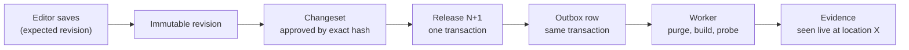

<p align="center">
  
</p>

<h1 align="center">Colophon CMS</h1>

<p align="center">
  <strong>A Rust + Svelte content management system that can prove what it published, and survives being killed at any moment.</strong>
</p>

<p align="center">
  <a href="https://404human.dev/colophon/">Build log</a> ·
  <a href="docs/END_GOAL.md">End goal</a> ·
  <a href="docs/SYSTEM_DESIGN.md">System design</a> ·
  <a href="docs/ROADMAP.md">Roadmap</a> ·
  <a href="docs/modules/README.md">Modules</a>
</p>

> **Status: milestone P0, foundation (October 2026).** The design is complete. Step 0.1 is done: a pinned toolchain,
> a five-crate Cargo workspace with no features yet, and CI that runs the same checks as `scripts/check.sh`. Step 0.2 is
> done: a local stack (PostgreSQL, Valkey, Garage, Keycloak) that proves each service works, in CI as well. Step 0.3
> is done: one error envelope, request IDs, honest health checks and `colophon doctor`, plus the testing rule every
> feature now follows: regression tests, a separate testbed frontend, and million-request load tests. Step 0.4 is
> done: the rich-text format (`colophon/rich-text` v1), 42 shared fixtures, and a Tiptap editor in the Studio that opens a
> document only if it can give it back byte for byte. Step 0.5 is done: the Rust validator refuses all 34 invalid
> fixtures with exactly the expected code and location, and writes the same canonical bytes as the editor.
> Nothing here claims that a feature, benchmark or security review already exists. Progress is logged step by step at
> **[404human.dev/colophon](https://404human.dev/colophon/)**.

---

## Why "Colophon"?

In a book, the *colophon* is the note at the back that records how, when and by whom it was printed. Colophon does the
same for a website: every publish becomes a numbered release, with a record of exactly what went live and where it was
actually seen.

Most content tools end a publish with a spinner and hope. Colophon ends it with a receipt.

## The four promises

| Promise | What you see | What makes it true |
|---|---|---|
| **Kill it at any moment, lose nothing** | No accepted edit disappears, no release runs twice, no reader sees half of one, even when the server or worker dies mid-publish | PostgreSQL transactions, a transactional outbox, idempotency keys, leased jobs, release generations |
| **Every bug is a number you can replay** | Thousands of seeded simulation runs on every pull request, with injected crashes and network faults; a failure replays exactly from its seed | A deterministic simulator (`colophon-sim`) plus a real-process crash loop |
| **Time travel** | Browse the whole site as it was at any release; rollback is just a new release pointing at older content | Immutable revisions and generation-based publication history |
| **Receipts, not spinners** | *Saved → Published in CMS → Website update pending → Verified at configured locations*, or *Needs attention* with a safe next action | Per-destination delivery states with stored evidence |

## How it works



- **PostgreSQL is the only source of truth.** The cache and the CDN make things fast and are allowed to forget
  everything.
- **No database transaction ever waits on the outside world.** Changes commit first; talking to the CDN or a site host
  happens afterwards, from the outbox, and leaves evidence.
- **Release numbers only go up.** A slow, stale worker can never put an older release back on the site.
- **One API for everyone.** The Studio, the `colophon` CLI, the TypeScript SDK and AI agents all go through the same
  Rust services and the same permission checks. Agents can draft and propose; they can never approve their own work.

More: [ARCHITECTURE.md](docs/ARCHITECTURE.md) for the structure, [SYSTEM_DESIGN.md](docs/SYSTEM_DESIGN.md) for the data
model, flows, consistency guarantees, capacity model and failure handling.

## Who it's for

- **Editors** write, preview, review and publish in the Studio, without a terminal and without needing to know what a
  cache is.
- **Developers** define schemas, run migrations and operate the install from the CLI and a typed REST API.
- **Scripts and agents** get scoped, budgeted tokens, stable JSON contracts and an MCP adapter.

## Stack

| Layer | Choice |
|---|---|
| Server | Rust (edition 2024): Axum, Tokio, Tower, SQLx; one binary with API and worker roles |
| Data | PostgreSQL 18 (authoritative); Valkey, a Redis-protocol cache (disposable); S3-compatible object storage (Garage locally) |
| Frontends | SvelteKit + TypeScript: the Studio (single-page app), the reference blog (prerendered), the docs (mdsvex + Pagefind) |
| Design system | Material Design 3 tokens on Bits UI primitives, with Tailwind CSS |
| Editor | Tiptap / ProseMirror, stored as validated, versioned JSON, never HTML |
| Identity | OIDC with Keycloak as the reference provider; sessions enforced by Rust and Postgres |
| Delivery | Cloudflare CDN adapter: tag purge and evidence probes |
| Verification | Unit and property tests, deterministic simulation, testcontainers, Vitest, Playwright, k6 |

Exact versions are pinned at milestone P0; the local stack's images are pinned by digest in `deploy/compose.yaml`.

## Roadmap

Each milestone is named after what it proves, and is done only when its proof gate passes with stored evidence.

| | Milestone | Proof gate | Status |
|---|---|---|---|
| D | Design | Scope cut, plan written, every decision recorded | ✅ Done |
| P0 | Foundation | Editor JSON round-trips; Rust rejects invalid documents; CI green | 🚧 In progress (0.1–0.5 done) |
| P1 | Never lose an edit | Kill-before/after-commit faults, safe conflicts, cross-project denial | Planned |
| P2 | Publish exactly once | Crashed workers reconcile; stale deliveries are superseded | Planned |
| P3 | Prove it reached the site | Cache and purge faults, no mixed releases; **first public demo** | Planned |
| P4 | Time travel and media | Rollback, pinned reads, revocation, safe uploads | Planned |
| P5 | Safe automation | Zero unauthorized agent actions; interrupted bulk jobs resume | Planned |
| P6 | Operate it | Full fault and load matrix, 24-hour soak, restore drill; **v0.1** | Planned |

Estimated at about 4–6 months to v0.1. Details: [ROADMAP.md](docs/ROADMAP.md).

**Deliberately not in v0.1:** commerce, payments, subscriptions, shipping and tax, hosting integrations and custom
domains ([parked](docs/modules/parked.md)). **Never:** untrusted native plugins, CRDT live co-editing, GraphQL,
active-active multi-region writes.

## Documentation

| Document | Answers |
|---|---|
| [WHY.md](docs/WHY.md) | Why this project exists and what it optimizes for |
| [END_GOAL.md](docs/END_GOAL.md) | What "done" means, the signature features, scope, quality bars |
| [ARCHITECTURE.md](docs/ARCHITECTURE.md) | Components, sources of truth, request paths, repository layout |
| [SYSTEM_DESIGN.md](docs/SYSTEM_DESIGN.md) | Requirements, capacity, data model, flows, consistency, failures, scaling, trade-offs |
| [ROADMAP.md](docs/ROADMAP.md) | Milestones P0–P6 with proof gates and estimates |
| [modules/](docs/modules/README.md) | 19 module plans: purpose, design, invariants, failure modes, tests |
| [DECISIONS.md](docs/DECISIONS.md) | Every deviation from the original spec, and the open questions |
| [brand/](docs/brand/README.md) | The logo and how to use it |
| [spec/](docs/spec/README.md) | The original 41-section master specification |
| [AGENTS.md](AGENTS.md) | Rules for AI coding agents working in this repository |

## Repository layout

What exists today:

```text
crates/
  colophon-domain/   the rules, starting with the rich-text validator (no I/O allowed; scripts/check-architecture.sh)
  colophon-db/       PostgreSQL adapter: a bounded, lazy pool and the readiness probe
  colophon-api/      the HTTP surface: error envelope, request IDs, middleware, /livez, /readyz
  colophon-cli/      the `colophon` binary (`colophon doctor`)
  colophon-server/   the `colophon-server` binary: config, probes, graceful shutdown (--role api|worker|all)
apps/
  studio/            the Studio: today, the editor spike
  testbed/           a separate SvelteKit frontend that tests Colophon through its real HTTP API
packages/
  editor/            Tiptap configured to exactly the rich-text format, and the canonical conversion
fixtures/            the shared rich-text fixtures: 12 valid documents, 30 that must be refused
perf/                k6 scenarios, every load result, and per-machine baselines
deploy/              compose.yaml: the local stack (PostgreSQL, Valkey, Garage, Keycloak); local.env
scripts/             check.sh (everything CI runs), stack.sh, testbed.sh, load.sh, install-k6.sh, and the checks
docs/                the plan; docs/formats/ holds the stored formats
```

The full target layout adds `apps/` (studio, web, docs), `packages/` (sdk, ui, content-renderer) and the remaining
crates as the milestones need them; see [ARCHITECTURE.md](docs/ARCHITECTURE.md).

## Development

Requirements: [rustup](https://rustup.rs) (it installs the pinned toolchain, Rust 1.99.1, from `rust-toolchain.toml`),
Docker with Compose, Node 22.17+, and optionally [cargo-deny](https://github.com/EmbarkStudios/cargo-deny) and
[k6](https://k6.io) (`scripts/install-k6.sh` installs the pinned version).

```sh
scripts/stack.sh up      # PostgreSQL, Valkey, Garage and Keycloak on 127.0.0.1, then 28 checks that each one works
scripts/check.sh         # everything CI runs: fmt, clippy -D warnings, tests, docs, architecture rule, cargo-deny,
                         # ShellCheck, and with the stack up: outage tests, the testbed in Chromium, a load smoke run
scripts/frontend.sh      # type checks, the editor's unit tests, and the Studio in Chromium
scripts/testbed.sh       # the testbed's Playwright suite (or --dev to explore it by hand)
npm run dev -w @colophon/studio   # the editor spike on http://127.0.0.1:58200
scripts/load.sh health throughput      # 1,000,000 requests against a release build; result in perf/results/
scripts/load.sh rich-text steady       # validation at 20,000 requests a second for a minute
```

Run the server against the local stack:

```sh
set -a; . deploy/local.env; set +a
cargo run --release -p colophon-server
cargo run --release -p colophon-cli -- doctor     # status, role and each dependency; exit 0 only when ready
```

Ports, credentials and what each stack check proves: [deploy/README.md](deploy/README.md).

If `scripts/check-toolchain.sh` reports a mismatch, another `cargo` (for example Homebrew's) is ahead of rustup's
proxies on your `PATH` and is ignoring the pin. Put rustup's proxies first, e.g.
`export PATH="$(brew --prefix rustup)/bin:$PATH"`.

## How it's tested

Every feature ships with three kinds of proof ([D-018](docs/DECISIONS.md)):

1. **Regression tests** in CI on every push, including tests against the real binary over real sockets, and tests that
   stop the database and cache to watch readiness change and recover. Every fixed bug gets a test that failed first.
2. **The testbed** (`apps/testbed`), a separate frontend that uses each feature through the real HTTP API, driven by
   Playwright in CI.
3. **Load tests** with k6. Results are committed, failures included, and a regression against the machine's baseline
   fails the run.

Step 0.3 on an Apple M2 Pro (12 cores), with k6 on the same machine (numbers about the code, not a production capacity
claim):

| Run | Requests | Rate | p99 | Failed | Database queries |
|---|---|---|---|---|---|
| Health endpoints, back to back | 5,000,000 | 75,405/s | 1.64 ms | 0 | 13 (all from the readiness probes) |
| Health endpoints, steady | 1,199,936 | 20,000/s for 60 s | 0.25 ms | 0 | 12 |
| Rich-text validation, back to back | 1,000,000 | 71,270/s | 2.28 ms | 0 | 5 |
| Rich-text validation, steady | 1,199,949 | 20,000/s for 60 s | 0.37 ms | 0 | 12 |

## Contributing

Colophon is in its foundation milestone. Issues with design feedback are welcome: a failure mode the plan misses, a guarantee
that is stronger than it can actually be, a simpler way to prove something. Code contributions open after P0, when the
workspace, CI and a `CONTRIBUTING.md` exist.

## How this is built

In the open, by one maintainer pairing with Claude Code, one tested checkpoint at a time. Risky code (database
migrations, authentication, publishing transitions, provider adapters) gets a line-by-line human review. Every step,
including the mistakes, is written up in the [build log](https://404human.dev/colophon/).

## License

Apache-2.0 is proposed for the core, CLI and SDK. The `LICENSE` file will be added once the maintainer confirms it,
before any release.
