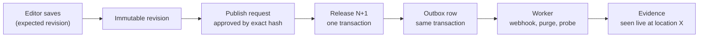

<p align="center">
  
</p>

<h1 align="center">Colophon CMS</h1>

<p align="center">
  <strong>A Rust + Svelte content management system that can prove what it published, and survives being killed at any moment.</strong>
</p>

<p align="center">
  <a href="https://404human.dev/colophon/">Build log</a> ·
  <a href="CHANGELOG.md">Changelog</a> ·
  <a href="docs/ROADMAP.md">Roadmap</a> ·
  <a href="docs/END_GOAL.md">End goal</a> ·
  <a href="docs/SYSTEM_DESIGN.md">System design</a> ·
  <a href="docs/modules/README.md">Modules</a>
</p>

> **Status (October 2026): pre-release; v0.1 is not out.** Milestones P0 (foundation), P1 (never lose an edit) and
> P2 (publish exactly once) are done: their proof gates passed with stored evidence. P3 (prove it reached the site) is
> under way: steps 3.1 to 3.7 are merged, and 3.8, the site going live with the first public demo, is next. Step 3.7,
> the path for people who aren't developers, is done except for checking every screen at phone width. Of the parity
> milestones, roles and permissions R.1 to R.3 (roles as data, roles that owners define, permissions narrowed to some
> fields or to a member's own entries) are done, and so is scheduled publishing from milestone E; R.4, API tokens and
> the audit log, is next. Each step's tests, decisions and load results are listed in [CHANGELOG.md](CHANGELOG.md),
> and each is written up, mistakes included, at **[404human.dev/colophon](https://404human.dev/colophon/)**. Nothing
> here claims a feature, benchmark or security review that doesn't exist.

---

## Why "Colophon"?

In a book, the *colophon* is the note at the back that records how, when and by whom it was printed. Colophon does the
same for a website: every publish becomes a numbered release, with a record of exactly what went live and where it was
actually seen.

Most content tools end a publish with a spinner and hope. Colophon ends it with a receipt.

## The four promises

| Promise | What you see | What makes it true | Where it stands |
|---|---|---|---|
| **Kill it at any moment, lose nothing** | No accepted edit disappears, no release runs twice, no reader sees half of one, even when the server or worker dies mid-publish | PostgreSQL transactions, a transactional outbox, idempotency keys, leased jobs, release generations | Done for saves and publishing (P1, P2): crash tests F01 to F05 and a real-process crash loop run in CI |
| **Every bug is a number you can replay** | Seeded simulation runs on every push and pull request, with injected crashes and network faults; a failure replays exactly from its seed | A deterministic simulator (`colophon-sim`) plus a real-process crash loop | Done (1.4, 2.4): CI sweeps 2,000 editing seeds and 1,000 publishing seeds |
| **Time travel** | Browse the whole site as it was at any release; rollback is just a new release pointing at older content | Immutable revisions and generation-based publication history | Reads pinned to any past release work through the delivery API (2.2); the Studio's release slider and rollback are planned (P4) |
| **Receipts, not spinners** | *Published in CMS → Website update pending → Verified at N locations*, or *Needs attention* | Per-destination delivery states with stored evidence; "verified" always says at how many locations | Done (3.3); one location by default |

## How it works



- **PostgreSQL is the only source of truth.** The cache and the CDN make things fast and are allowed to forget
  everything.
- **No database transaction ever waits on the outside world.** Changes commit first; talking to the CDN or a site host
  happens afterwards, from the outbox, and leaves evidence.
- **Release numbers only go up.** A slow, stale worker can never put an older release back on the site.
- **One API for everyone.** The Studio and the `colophon` CLI go through the same Rust services and the same permission
  checks; the TypeScript SDK (milestone D) and AI agents (P5) will too. Agents will be able to draft and propose,
  never approve their own work.

More: [ARCHITECTURE.md](docs/ARCHITECTURE.md) for the structure, [SYSTEM_DESIGN.md](docs/SYSTEM_DESIGN.md) for the data
model, flows, consistency guarantees, capacity model and failure handling.

## Who it's for

- **Editors** write, review and publish in the Studio, in plain words, without a terminal and without needing to know
  what a cache is.
- **Developers** define content types in the Studio's builder or through the REST API, and work from the `colophon`
  CLI. A typed SDK is planned (milestone D).
- **Scripts and agents** use bearer tokens today, which act with their person's full rights. Scoped API tokens (R.4),
  budgeted machine credentials and an MCP adapter (P5) are planned.

## Stack

| Layer | Choice |
|---|---|
| Server | Rust (edition 2024): Axum, Tokio, Tower, SQLx; one binary with API and worker roles |
| Data | PostgreSQL 18 (authoritative); Valkey, a Redis-protocol cache (disposable); S3-compatible object storage (Garage locally, not used yet) |
| Frontends | SvelteKit + TypeScript: the Studio (a single-page app the server serves), the testbed, the reference site (prerendered from one release), and the website and the docs (mdsvex + Pagefind), which aren't merged into `main` yet |
| Design system | Colophon's own: OKLCH tokens, Tailwind CSS v4, owned shadcn-svelte components on Bits UI, Inter (self-hosted) |
| Editor | Tiptap / ProseMirror, stored as validated, versioned JSON, never HTML |
| Identity | OIDC with Keycloak as the reference provider; sessions enforced by Rust and Postgres |
| Delivery | Webhooks, CDN purges by cache tag and probes of the live site, from the worker; the purges are tested against a fake CDN, and a Cloudflare adapter isn't built yet |
| Verification | Unit and property tests, deterministic simulation, real PostgreSQL in a fresh database per test, Vitest, Playwright, k6 |

The toolchain is pinned in `rust-toolchain.toml` and the lockfiles; the local stack's images are pinned by digest in
`deploy/compose.yaml`.

## Roadmap

Thirteen milestones, each named after what it proves; one is done only when its proof gate passes with stored
evidence. Since D-057 the goal is every feature Strapi and Sanity offer, built to the same bar, so the lettered
milestones sit between the numbered ones.

| Order | Milestone | Proof gate | Estimate | Status |
|---|---|---|---|---|
| P0 | Foundation | Editor JSON round-trips; Rust rejects invalid documents; CI is green | 1–2 weeks | Done |
| P1 | Never lose an edit | F01, F02, F04; cross-project denial; first simulator runs | 3–5 weeks | Done |
| P2 | Publish exactly once | F03, F05; concurrent releases; simulator covers the outbox; first crash loop | 3–4 weeks | Done |
| P3 | Prove it reached the site | F06–F08, L01–L04, mixed-release checker; **first public demo** | 3–4 weeks | Under way: 3.1–3.7 merged, 3.8 next |
| R | Roles and permissions | Every action × role × field × condition decided by one evaluator; no permission check bypassed in the API, CLI or Studio | 2–3 weeks | Under way: R.1–R.3 merged, R.4 next |
| M | Content modelling parity | Relations, components, lists, blocks and single types round-trip and stay valid through schema changes | 4–6 weeks | Planned |
| P4 | Time travel and media | Rollback, pinned reads, revocation, upload fault tests, the media library | 3–4 weeks | Planned |
| E | Editorial parity | Localization, scheduling, review stages, comments, tasks and live collaboration without a lost edit | 5–7 weeks | Under way: scheduled publishing merged |
| D | Developer parity | Query API, GraphQL, SDK, API tokens, import from Strapi and Sanity, extension points | 4–5 weeks | Planned |
| S | Scale and performance | Several servers and workers behind a load balancer survive kills and drains; every scenario has a stored stress result; Rust benchmarks gate CI (D-062) | 2–3 weeks | Planned |
| V | Versions and distribution | One version across server, CLI, SDK and MCP; the CLI installs from npm, Cargo, Homebrew and a script on a clean machine (D-062) | 1–2 weeks | Planned |
| P5 | Safe automation | Zero unauthorized actions in the eval set; interrupted bulk job resumes (X12) | 3–4 weeks | Planned |
| P6 | Operate it | F09–F14, L05–L13, 24-hour soak, restore drill; **v0.1 release** | 3–4 weeks | Planned |

The estimates are guesses, not measurements: about 10–13 months to v0.1 at the pace they assume, with the first public
demo at the end of P3. Details: [ROADMAP.md](docs/ROADMAP.md); feature by feature against Strapi and Sanity:
[COMPARISON.md](docs/COMPARISON.md).

**Parked, not in v0.1:** commerce, payments, inventory, shipping, tax, refunds, subscriptions and entitlements; hosting
adapters; custom domains; membership and knowledge-base templates ([parked](docs/modules/parked.md)). **Non-goals:**
untrusted native plugins running inside the server (milestone D offers safe extension points instead), active-active
multi-region database writes, multi-seller marketplaces, usage-based billing, autonomous production repair, and
hostile-tenant open registration. GraphQL and real-time collaboration used to be non-goals; since D-057 they are in
scope, in milestones D and E.

## Documentation

| Document | Answers |
|---|---|
| [WHY.md](docs/WHY.md) | Why this project exists and what it optimizes for |
| [END_GOAL.md](docs/END_GOAL.md) | What "done" means, the signature features, scope, quality bars |
| [ARCHITECTURE.md](docs/ARCHITECTURE.md) | Components, sources of truth, request paths, repository layout |
| [SYSTEM_DESIGN.md](docs/SYSTEM_DESIGN.md) | Requirements, capacity, data model, flows, consistency, failures, scaling, trade-offs |
| [ROADMAP.md](docs/ROADMAP.md) | The thirteen milestones with proof gates, steps and estimates |
| [COMPARISON.md](docs/COMPARISON.md) | Every Strapi and Sanity feature, and where Colophon stands on each |
| [CHANGELOG.md](CHANGELOG.md) | Every merged step, with its decisions and its proof |
| [RELEASES.md](docs/RELEASES.md) | How Colophon tells people what changed: the changelog, release notes, upgrade guides |
| [modules/](docs/modules/README.md) | 20 module plans: purpose, design, invariants, failure modes, tests; and the parked list |
| [DECISIONS.md](docs/DECISIONS.md) | Every deviation from the original spec, and the open questions |
| [brand/](docs/brand/README.md) | The logo and how to use it |
| [spec/](docs/spec/README.md) | The original 41-section master specification |
| [AGENTS.md](AGENTS.md) | Rules for AI coding agents working in this repository |

## Repository layout

```text
crates/
  colophon-domain/   the rules: rich text, content types, publish requests, releases, permissions, schedules
                     (no I/O allowed; scripts/check-architecture.sh)
  colophon-db/       PostgreSQL: the migrations, row-level security, transactions and the outbox
  colophon-auth/     OpenID Connect sign-in, and the tokens behind sessions, CSRF and setup codes
  colophon-api/      the HTTP API: /api/v1, the public /content/v1, the error envelope, the Studio's files
  colophon-worker/   deliveries under leases (webhooks, CDN purges, probes) and scheduled publishes
  colophon-sim/      the deterministic simulator
  colophon-cli/      the `colophon` binary
  colophon-server/   the `colophon-server` binary (--role api|worker|all)
  colophon-mcp/      the `colophon-mcp` binary: an MCP server on stdio for agents, over the same HTTP API (D-068)
  colophon-version/  the version, commit and build date every binary reports (--version, GET /version)
  colophon-bench/    Criterion micro-benchmarks of the per-request hot paths and their inputs (D-074)
apps/
  studio/            the Studio, served by the server at /studio
  testbed/           a separate SvelteKit app that uses every feature through the real HTTP API
  web/               the reference site, built from exactly one release
  site/              the public website (not merged into main yet)
  docs/              the documentation site (not merged into main yet)
packages/
  editor/            Tiptap configured to exactly the rich-text format, and the canonical conversion
  content-renderer/  stored documents to safe HTML, one implementation for the Studio and the public site
  ui/                the design system: tokens and the owned shadcn-svelte components
  site-theme/        the website's look, shared by the website and the docs
  cli-npm/           @colophon-cms/cli: the npm launcher for the prebuilt `colophon` binaries
packaging/           the Homebrew formula template (scripts/homebrew-formula.sh fills it in per release)
fixtures/            the shared rich-text contract: 12 valid documents with their reviewed HTML, 34 that must be refused
perf/                k6 scenarios, every load and micro-benchmark result, per-machine baselines, and a webhook receiver
deploy/              compose.yaml: the local stack (PostgreSQL, Valkey, Garage, Keycloak); local.env
scripts/             check.sh (everything CI runs), stack.sh, migrate.sh, load.sh, demo.sh, first-run.sh and the checks
docs/                the plan and the design documents; docs/formats/ holds the stored formats
```

## Development

Requirements: [rustup](https://rustup.rs) (it installs the pinned toolchain, Rust 1.99.1, from `rust-toolchain.toml`),
Docker with Compose, Node 22.17+ (Node 24 for the reference site and `scripts/demo.sh`), and optionally
[cargo-deny](https://github.com/EmbarkStudios/cargo-deny) and [k6](https://k6.io) (`scripts/install-k6.sh` installs the
pinned version).

```sh
npm ci                   # the frontend workspace
scripts/stack.sh up      # PostgreSQL, Valkey, Garage and Keycloak on 127.0.0.1, then checks that each one works
scripts/migrate.sh       # apply the migrations as the owner login, and make dev-owner the first administrator
scripts/demo.sh          # the server, the Studio and the worker on :58000 and the reference site on :58099,
                         # against a demo database of their own with a seeded project
scripts/first-run.sh     # a brand-new installation on :58400: sign up, then enter the setup code it prints
```

Checks:

```sh
scripts/check.sh         # everything CI runs: fmt, clippy -D warnings, tests, docs, architecture rule, cargo-deny,
                         # ShellCheck, and with the stack up: outage tests, the testbed in Chromium, load smoke runs
scripts/frontend.sh      # type checks, the editor's unit tests, and the Studio in Chromium
scripts/testbed.sh       # the testbed's Playwright suite (or --dev to explore it by hand)
scripts/studio.sh        # the Studio against the real server: autosave, conflicts, offline, recovery
npm test -w @colophon/docs   # the docs site: build, then Playwright
npm test -w @colophon/site   # the website: build, then Playwright
cargo run -p colophon-cli -- login --server http://localhost:58000   # then approve the code in the Studio
scripts/bench.sh                       # micro-benchmarks of the per-request hot paths; medians in perf/results/
scripts/bench.sh compare main          # this checkout against main, both built and timed on this machine
```

Load runs (they build the release binaries; each result goes in `perf/results/` with the machine and commit):

```sh
scripts/load.sh health throughput      # 1,000,000 requests, back to back
scripts/load.sh rich-text steady       # a fixed rate for 60 seconds
scripts/load.sh roles throughput       # any scenario: health, rich-text, session, cli, members, roles, schedules,
                                       # projects, setup, changesets, delivery, publishing, entries, content-types,
                                       # studio, site
```

Run the server against the local stack yourself:

```sh
scripts/migrate.sh
set -a; . deploy/local.env; set +a
cargo run --release -p colophon-server
cargo run --release -p colophon-cli -- doctor     # status, role and each dependency; exit 0 only when ready
```

Then open `http://localhost:58000/auth/login?return_to=/me` and sign in as `dev-owner` or `dev-editor` (password
`colophon-dev`): you land on `/me`, which shows who you are and your projects.

To use the Studio, build it and point the server at the build before starting it:

```sh
npm run build -w @colophon/studio
COLOPHON_STUDIO_DIR="$PWD/apps/studio/build" cargo run --release -p colophon-server
```

and open `http://localhost:58000/studio/`. For the command line, `cargo run -p colophon-cli -- login` signs in to
`http://localhost:58000` through a code you approve in the Studio. The Studio's own dev server is
`npm run dev -w @colophon/studio` on `http://127.0.0.1:58200`, against a server on `:58000`.

Ports, credentials and what each stack check proves: [deploy/README.md](deploy/README.md).

If `scripts/check-toolchain.sh` reports a mismatch, another `cargo` (for example Homebrew's) is ahead of rustup's
proxies on your `PATH` and is ignoring the pin. Put rustup's proxies first, e.g.
`export PATH="$(brew --prefix rustup)/bin:$PATH"`.

## How it's tested

Every feature ships with three kinds of proof ([D-018](docs/DECISIONS.md)):

1. **Regression tests** in CI on every push, including tests against the real binary over real sockets, and tests that
   stop the database and cache to watch readiness change and recover. Every fixed bug gets a test that failed first.
2. **The testbed** (`apps/testbed`), a separate frontend that uses each feature through the real HTTP API, driven by
   Playwright in CI.
3. **Load tests** with k6, each with thresholds: a throughput run sends 1,000,000 requests back to back, a steady run
   holds a fixed rate for 60 seconds, and CI runs smaller smoke runs on every push.

On top of those, CI sweeps the deterministic simulator (2,000 editing seeds and 1,000 publishing seeds a run), runs
the crash tests F01 to F03 with fault points compiled in, and kills the real server repeatedly in a crash loop.

Every load result is kept in [`perf/results/`](perf/results/), misses and failures included: one JSON file per run with
its machine, commit, parameters, latency percentiles and whether it met its thresholds, and
[`history.jsonl`](perf/results/history.jsonl) lists them in order. A run fails against the machine's accepted
baseline (`perf/baselines/`) when its p99 is more than 1.5 times the baseline's, or a throughput run is under 75% of
its rate. Baselines are per machine and never compared across machines. The runs so far are on one laptop, an Apple M2 Pro with 12 cores:
they are evidence about the code, not a statement about production capacity.

## Contributing

Colophon is pre-release. Issues with design feedback are welcome: a failure mode the plan misses, a guarantee that is
stronger than it can actually be, a simpler way to prove something. Code contributions open once there is a
`CONTRIBUTING.md` and the licence is confirmed (O-014); neither exists yet.

## How this is built

In the open, by one maintainer pairing with Claude Code, one tested step at a time. Risky code (database migrations,
authentication, publishing transitions, provider adapters) gets a line-by-line human review. Every step, including the
mistakes, is written up in the [build log](https://404human.dev/colophon/).

## License

Apache-2.0 is proposed for the core, CLI and SDK. The `LICENSE` file will be added once the maintainer confirms it,
before any release; the release workflow refuses a tag without it.
