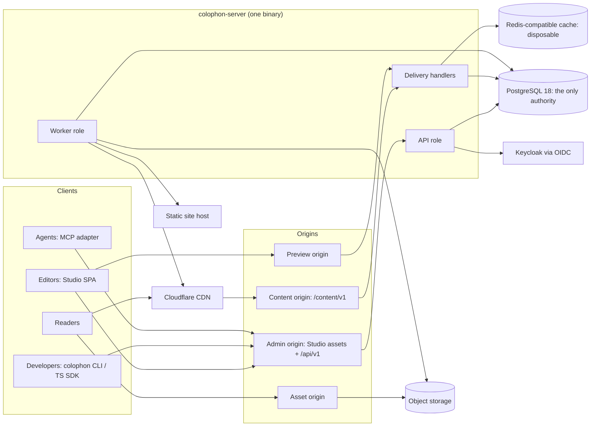
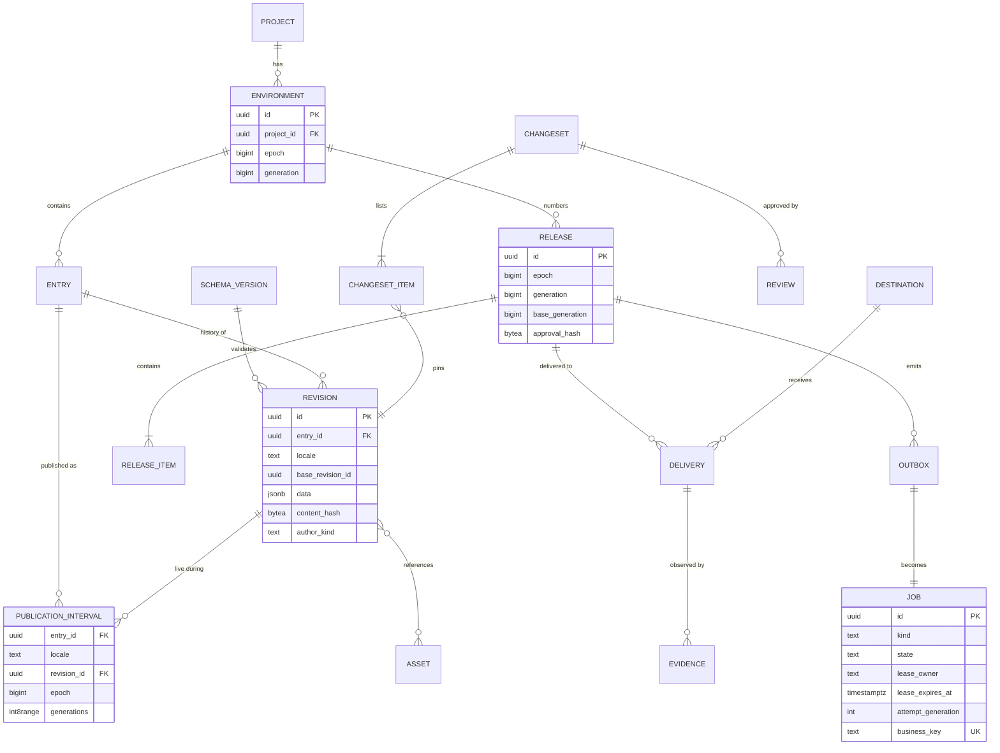
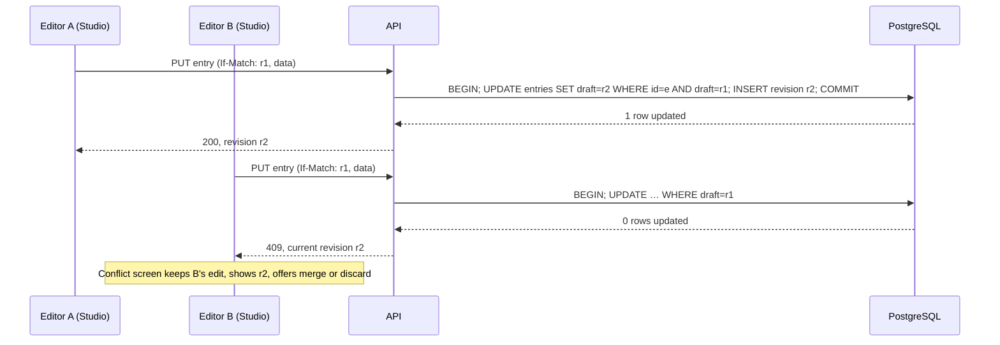
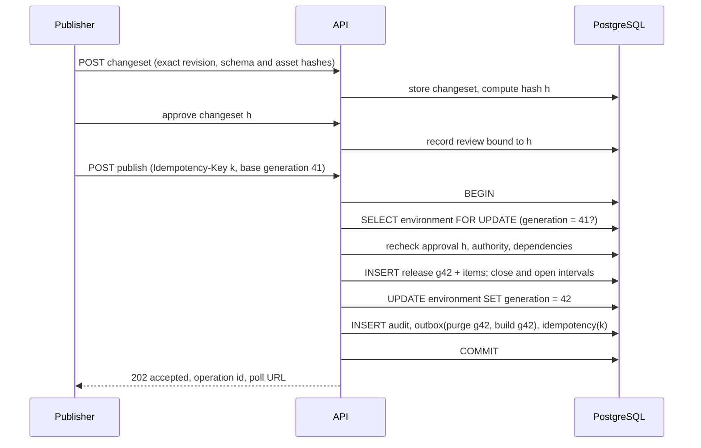
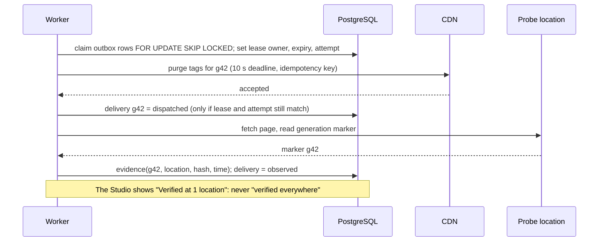
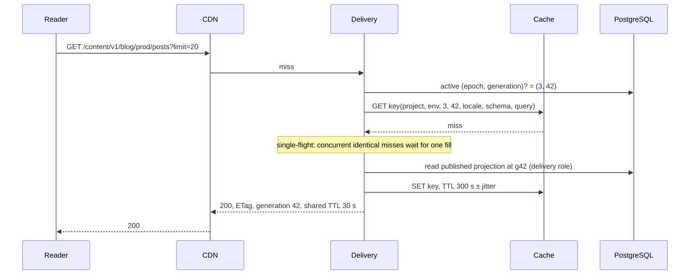
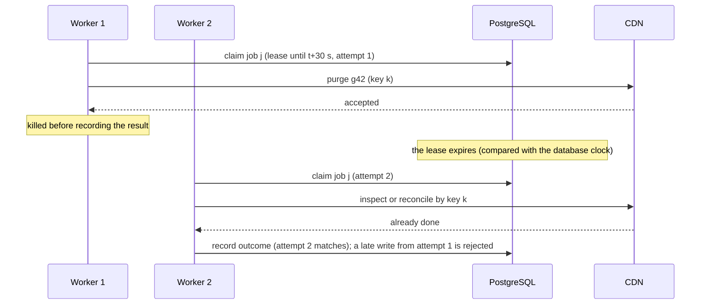
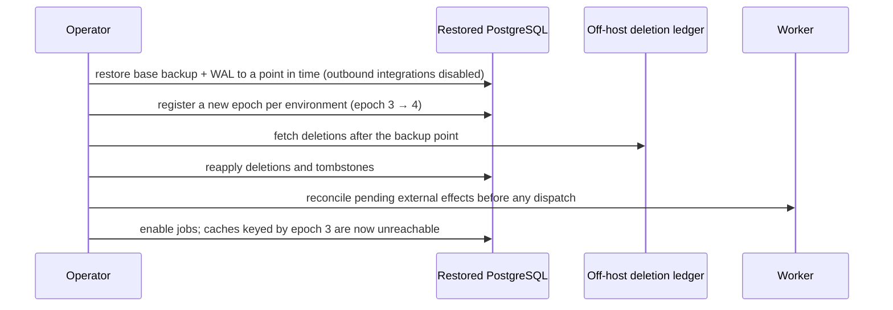
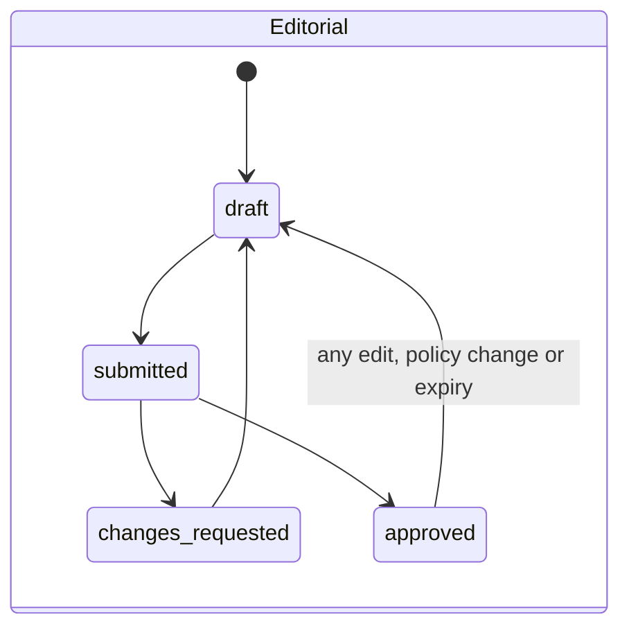
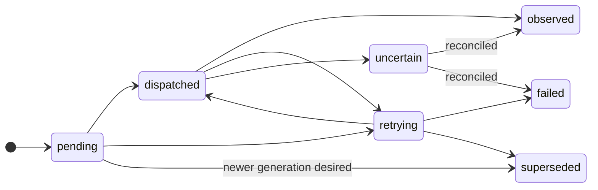

# System design

How Colophon behaves as a running system: requirements, capacity, data model, the important flows, consistency
guarantees, caching, failure handling, scaling and trade-offs. [ARCHITECTURE.md](ARCHITECTURE.md) covers the static
structure (components, repository layout, crate boundaries), and the module docs hold the detail. Diagrams use Mermaid,
which GitHub renders.

> Design, not evidence. Every number here is a target or an estimate from the spec's reference workload (spec §28).
> Nothing has been measured yet.

## 1. Requirements

### Functional

| Area | The system must |
|---|---|
| Authoring | Store schema-validated drafts as immutable revisions; detect concurrent edits; support locales; attribute every change to a human or an agent |
| Review | Bind approvals to an exact changeset; invalidate them on any change; never let an agent approve its own proposal |
| Publishing | Commit a reviewed changeset as one numbered release; roll back by creating a new release; unpublish with revocation; schedule releases across time zones |
| Delivery | Serve only published content; cache it safely; invalidate precisely; record evidence of where each release was observed |
| Time travel | Read any past release consistently; browse it in the Studio |
| Media | Accept uploads through quarantine; publish only verified assets; never delete an asset that a draft or retained release references |
| Automation | Give scripts and agents scoped, budgeted, auditable access through the same API |
| Operations | Back up and restore without replaying external effects blindly; upgrade without downtime for additive changes |

### Non-functional

| Quality | Target |
|---|---|
| Correctness | Zero lost acknowledged saves, duplicated logical releases, cross-project disclosures or false success states in the defined tests (stop conditions) |
| Durability | Recovery point objective 15 min, recovery time objective 1 h on the reference profile (spec §32); proven by restore drills |
| Read latency | Warm origin p95 ≤ 150 ms, p99 ≤ 350 ms at 300 req/s; warm CDN p95 TTFB ≤ 150 ms per region |
| Write latency | Draft save p95 ≤ 300 ms at 20 writes/s plus 100 reads/s; release commit p95 ≤ 500 ms |
| Freshness | Publish to probe visibility on the direct edge API: p95 ≤ 10 s, p99 ≤ 30 s |
| Availability | Degrade instead of failing: cache loss keeps reads and writes working; provider loss keeps editing working and shows "pending" |
| Security | Relevant OWASP ASVS 5.0 Level 2 controls, with negative tests (self-assessed) |
| Operability | Every job, delivery and release is inspectable from the Studio and the CLI with a safe next action |

## 2. Capacity model (reference workload)

The spec's dataset D1: 3 projects, 10 collections per project, 100,000 entries in total, 3 revisions per entry,
~6 KiB of content per revision, 10,000 asset records.

| Quantity | Estimate | Consequence |
|---|---|---|
| Revision bytes | 300,000 × 6 KiB ≈ 1.7 GiB of JSON | Fits easily on one Postgres node; indexes and history roughly 2–3× that |
| Publish write amplification | Per release with 10 entries: 1 release row, 10 items, ~20 interval updates (close + open), audit and 2–3 outbox rows ≈ 40 row writes | 5 releases/s ≈ 200 row writes/s: modest |
| Autosave growth | 20 saves/s at peak ≈ 72,000 revisions/hour | Debounced autosave plus 90-day retention of unpinned revisions; possible compaction of consecutive autosaves (open question) |
| Outbox throughput | 8 delivery slots ÷ 10 s worst-case deadline = 0.8 jobs/s when a provider hangs; typical purge calls of a few hundred ms give tens of jobs/s | Backlog is bounded by **supersession**: per destination only the newest desired generation matters, so a stalled provider builds O(destinations) of work, not O(releases) |
| API pool | 20 connections; 5 ms queries give ~4,000 queries/s; 2 s worst-case queries give 10/s | Admission control and 503 shedding are required, not optional |
| Cache working set | One representation of every entry ≈ 600 MB; list queries extra | The 1 GiB budget holds the hot set; eviction keeps it bounded |

## 3. High-level architecture

The API and delivery handlers run in the same process in v0.1. They are separate roles so they can be split later if
load tests justify it.

## 4. Data model

### Core entities

Every table also carries `project_id` and `environment_id`. Foreign keys include them, so a reference cannot cross a
project or environment.

### How a pinned read finds content

For entry *e* in locale *l* at generation *g* in epoch *k*, the live revision is the single publication interval with
`entry_id = e AND locale = l AND epoch = k AND generations @> g`. Because intervals for one entry and locale never
overlap, there is at most one match. No match means the entry was not published at *g*. Revocation (a tombstone) is
then checked, so unpublished content stays unavailable even through historical URLs.

## 5. Key flows

### 5.1 Saving a draft, with a conflict

### 5.2 Reviewing and publishing

If another release committed first, the generation check fails and the publisher gets a 409 asking for a rebase. A
retry with the same key `k` returns the recorded result instead of publishing twice.

### 5.3 Delivering and proving it

### 5.4 A public read, cache miss and stampede protection

The active generation always comes from Postgres on an origin miss, so a stale cache entry can never bring back an
older release.

### 5.5 A worker dies after the external call (fault F03)

Lease expiry is evaluated with the database's clock (`now()`), never a worker's, so clock skew between machines cannot
hand a job to two workers at once.

### 5.6 Restoring a backup

## 6. State machines

The second diagram is a destination delivery. Jobs follow the same pattern with `running`, `succeeded` and `cancelled`
added. A release is simpler: `prepared → committed`, and a committed release never changes. Rollback is a new release.

## 7. Consistency model

| Operation | Guarantee | Mechanism |
|---|---|---|
| Draft save | Linearizable per entry and locale; no lost update | Conditional update on the draft pointer in one transaction |
| Release ordering | Total order per environment | Row lock on the environment and a base-generation check |
| Mutations under retry | Effectively once | Idempotency key + request hash, recorded with the effect |
| External effects | At least once, made safe by idempotency keys and reconciliation; `uncertain` when that is impossible | Outbox, leases, provider operation IDs |
| Studio reads | Read-your-writes | The Studio reads the management API, never a shared cache |
| Pinned public reads | Snapshot consistency across related reads | `(epoch, generation)` pinned by the SDK; immutable once committed |
| Live public reads | Bounded staleness: CDN shared TTL 30 s plus purge; evidence records the real freshness | Generation-keyed cache, tag purge, probes |
| Revocation | Immediate at the origin; bounded at caches; impossible for copies already downloaded | Tombstone checked before serving; purge; disclosed exposure |

## 8. Caching design

- **Keys** contain project, environment, epoch, generation, locale, schema/renderer version, normalized query and
  representation (spec §15). Generation keys make poisoning across releases impossible: a fill for g41 can only ever be
  read as g41.
- **TTLs:** live queries and active-release metadata 30 s shared at the CDN; pinned content 300 s; cache results 300 s
  with jitter; browsers 0 s with revalidation.
- **Invalidation:** tags per entry, collection, locale and known references, starting coarse (collection-level). A new
  entry matching a listing invalidates that listing even though it wasn't in the old response (F06).
- **Stampedes:** single-flight per key on misses; admission limits on database fallback; no unbounded parallel
  regeneration (L04).
- **Never cached publicly:** previews, drafts, sessions, personalized responses. `stale-on-error` is off for removal
  paths.

## 9. Concurrency and resource control

| Control | Where | Why |
|---|---|---|
| Database pools (API 20, worker 10) with a 2 s statement timeout | db | One slow query can't take the service down |
| Tower timeout, concurrency limit, body limit (1 MiB) | api | Bounded work per request |
| Per-principal rate limits (429) and pool/queue admission (503 + `Retry-After`) | api, worker | Shed load deliberately instead of queueing forever |
| Separate semaphores: 8 delivery (≤ 2 per destination), 4 image, 2 AI | worker | Expensive work can't starve editorial saves |
| One active publication stream per project and environment | worker | Ordered delivery, and supersession instead of backlog |
| Budget reservations in Postgres before agent work | automation | Cost and volume caps that Redis loss can't bypass |
| Pending-job caps (10,000 per project) | worker | Durable capacity is reserved before work is accepted |

## 10. Failure handling and degraded modes

| Failure | Behaviour | Users see |
|---|---|---|
| PostgreSQL down | Writes fail with 503; nothing is acknowledged from memory; eligible public data is served from cache within TTL | "Can't save right now"; drafts kept locally with consent |
| PostgreSQL slow | Statement timeouts, pool admission, shedding | Some 503s with `Retry-After`; no pile-up |
| Cache down | Bypass with request coalescing and capped database fallback; authorization and budgets unaffected | Slower public reads; editing unaffected |
| CDN purge failing (429/5xx) | Backoff, retry the newest desired generation only, mark pending or uncertain | "Website update pending", with a retry action |
| Site build fails | The previous site stays live; the newer generation stays pending | "Needs attention" with build logs |
| Identity provider down | Existing valid sessions continue per policy; new sign-ins fail clearly | Sign-in error; signed-in editors keep working |
| Object storage down | Uploads fail clearly; text editing continues | Upload error |
| Worker killed | Leases expire; another worker reclaims and reconciles | Possibly a delay; never a duplicate claimed as success |
| API killed mid-request | Uncommitted work is not acknowledged; a committed result is returned by the idempotent retry | A retry that returns the same result |
| Disk pressure | Warn at 70%, reject optional growth at 85%, block unsafe writes before 90% | Clear capacity errors |

## 11. Scaling path

1. **v0.1:** one server process (`--role all`), one Postgres primary, one cache, CDN in front. This is the reference
   profile.
2. **Split roles:** run `--role api` and `--role worker` separately when worker load affects API latency.
3. **Separate delivery processes** when public read volume justifies independent scaling. Delivery stays read-only.
4. **Read replicas for delivery:** allowed only for pinned reads at generations the replica has already replayed.
   The active generation is still resolved from the primary, so replica lag can never show an older release as current.
5. **Partitioning:** `audit_log`, `outbox` and `revisions` by time or project once measurements show it is needed.
6. **More regions:** through the CDN for reads. A single writer region stays; active-active writes are a non-goal.

## 12. Security architecture (summary)

- **Trust boundaries:** browser ↔ admin origin (session cookie, CSRF, Origin checks); CLI and agents ↔ API (scoped
  bearer tokens); readers ↔ CDN and content origin (public only); worker ↔ providers (server-side credentials,
  allowlisted egress, SSRF guards); application ↔ database (least-privilege roles, row-level security as defence in
  depth).
- **Separate origins** for administration, content, assets and preview, so uploaded files and preview pages can't run
  with administrator privileges.
- **No secret reaches a browser or an agent:** provider keys stay on the server; tokens are hashed at rest; logs carry
  identifiers, never bodies, prompts or secrets.
- Full controls and tests: [modules/03-auth.md](modules/03-auth.md), [modules/17-verification.md](modules/17-verification.md).

## 13. Observability

- **Correlation:** `request_id`, project, actor, revision, release `(epoch, generation)`, job, destination, deployment
  version. Trace context is stored in outbox rows, so a publish can be followed from the click to the probe.
- **Key signals:** HTTP error rate and latency, save conflicts, publish lag (commit → observed), queue age, failed and
  uncertain deliveries, cache hit ratio, pool saturation and lock waits, WAL size, cache memory and evictions, agent
  budget use, dropped log records.
- **Health:** `/livez` means the process responds. `/readyz` means this role can safely serve: cache loss can be
  "degraded but ready", database loss is "not ready" for writes.

## 14. Trade-offs and alternatives considered

| Decision | Chosen | Rejected, and why |
|---|---|---|
| Service shape | Modular monolith with roles | Microservices: more failure modes and operations work for a single-maintainer project, with no measured need |
| Content storage | Relational metadata + JSONB revisions validated by versioned schemas | A SQL table per collection: arbitrary DDL per customer schema makes migrations and isolation harder (spec §07) |
| Background work | Postgres transactional outbox | A separate message broker: another system to operate, and it still needs an outbox to stay consistent with the database |
| Concurrency | Optimistic revisions with a conflict screen | CRDT live co-editing: much more complex; an explicit non-goal |
| Cache | Disposable, generation-keyed Redis-compatible store | Making the cache authoritative: loses correctness when the cache does |
| Studio rendering | Static SPA served by Rust | SvelteKit server rendering: a second backend with its own authority |
| API style | REST + OpenAPI | GraphQL: unbounded query shapes conflict with strict cost limits; a non-goal |
| Identity | OIDC with Keycloak | A home-grown password system: a large security surface with no differentiation |
| Testing | Deterministic simulation + real-process crash loop + integration tests | Integration tests alone: rare races stay rare and unreproducible |
| Design system | Material 3 tokens on Bits UI (D-011) | `@material/web` (maintenance mode), MUI (React-only) |

## 15. Open questions

Tracked in [DECISIONS.md](DECISIONS.md). The design-specific ones:

- Compacting consecutive autosave revisions without breaking references from comments and changesets.
- Synchronous vs async domain ports (O-005), which shapes how easily the simulator can drive the core.
- Publication intervals enforced by an exclusion constraint or by a locked application check.
- How many probe locations v0.1 can honestly offer (O-012).
